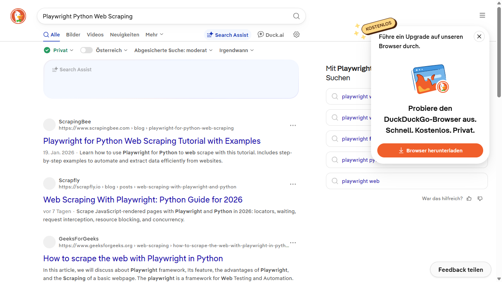
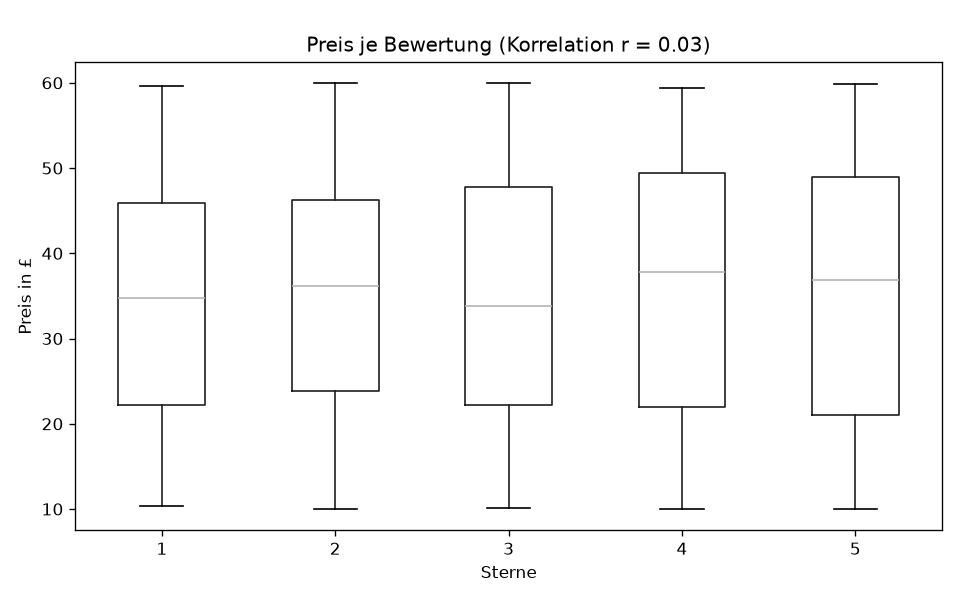

# 🎸 Kultur-Radar Innsbruck – Web-Scraping mit Playwright, Pandas & browser-use

> **INFI-IS Übung 04** (5xHWII, HTL Anichstraße) – *Holen von Daten mittels Playwright und Pandas*

Statt nur Daten abzugreifen, beantwortet dieses Projekt echte Alltagsfragen eines Schülers in Innsbruck:

| Frage | Skript | Ergebnis |
|---|---|---|
| *Was läuft diese Woche im Treibhaus – und wie bekomme ich das in meinen Handy-Kalender?* | `01_treibhaus.py` | CSV + **`.ics`-Kalenderdatei** (Google/Outlook/Apple) |
| *Lohnt sich das Konzert? Wie klingt die Band?* | `02_ddg_suche.py --kultur-radar` | automatisch gefundene **YouTube-/Spotify-/Bandcamp-Links** je Konzert |
| *Was finde ich zu Suchbegriff X?* | `02_ddg_suche.py "X"` | Screenshot + Trefferliste als CSV |
| *Wo sind die Schnäppchen im Shop? Sind teure Bücher besser?* | `03_books_katalog.py` | gesamter Bestand (1000 Bücher), Schnäppchenliste, Plot |
| *Welche Abgaben stehen in Moodle an?* (Login-Bereich) | `04_moodle_deadlines.py` | CSV + `.ics` mit Erinnerung 1 Tag vorher |
| *Brauche ich noch Selektoren, wenn es KI-Agenten gibt?* | `05_browser_use_vergleich.py` | Messtabelle Playwright vs. LLM-Agent |

---

## ⚙️ Installation

```bash
pip install -r requirements.txt
playwright install chromium
cp .env.example .env        # Windows: copy .env.example .env
```

Getestet mit Python 3.14, Playwright 1.65, pandas 3.0, browser-use 1.0.6 unter Windows 11.

---

## 1️⃣ Treibhaus-Programm → CSV + Kalender (Aufgabe 2)

```bash
python 01_treibhaus.py
python 01_treibhaus.py --interessen jazz,blues,kabarett   # nur was mich interessiert
```

**Wie es funktioniert:** Das Programm auf treibhaus.at ist mit [schema.org/Event](https://schema.org/Event)-Microdata ausgezeichnet. Das ist der stabilste Ansatzpunkt, weil sich solche Attribute (anders als CSS-Klassen fürs Design) selten ändern:

```python
for ev in page.locator('div[itemprop="event"]').all():
    beginn = ev.locator('span[itemprop="startDate"]').get_attribute("content")  # "2026-11-18T20:00:00"
    titel  = ev.locator('span[itemprop="name"]').inner_text()
    link   = ev.locator('a[itemprop="url"]').get_attribute("href")
```

Im sichtbaren Text steht teilweise nur `20:00 UHR` (wenn mehrere Events am selben Tag sind). Das `content`-Attribut liefert dagegen **immer das vollständige ISO-Datum**.

**Mehrwert:**
- **Kategorie** (Konzert, Kabarett/Theater, Lesung, Party/DJ …) per Stichwortsuche
- **`data/treibhaus.ics`** im iCalendar-Format (RFC 5545) zum Importieren in jede Kalender-App
- `--interessen` filtert auf persönliche Stichwörter und erzeugt einen eigenen Kalender

Beispielausgabe (`data/treibhaus_events.csv`, 80 Events, Stand 18.11.2026):

| datum | beginn | kategorie | titel |
|:--|:--|:--|:--|
| 2026-11-18 | 20:00 | Konzert | MOMI MAIGA: KORA, STIMME, CELLO, GEIGE // SENEGAL |
| 2026-11-19 | 20:00 | Konzert | VIVID EVE // STEFANIE FETTNER & HANS HAUSER // ALBUM RELEASE |
| 2026-11-21 | 20:00 | Konzert | NEIL COWLEY TRIO: ENTITY - EINE REUNION // POST JAZZ |

---

## 2️⃣ DuckDuckGo-Suche mit Parameter (Aufgabe 3)

```bash
python 02_ddg_suche.py "Playwright Python Web Scraping"
python 02_ddg_suche.py "Neil Cowley Trio" --anzahl 5
```

Ablauf laut Angabe: Chromium öffnen → duckduckgo.com → Suchfeld finden und **automatisch** befüllen → auf Ergebnisse warten → **Screenshot** → Treffer (Rang, Titel, Link, Domain, Snippet) als CSV.



**Erkenntnisse aus dem Quellcode (Strg+U / F12):**
- Das Suchfeld ist inzwischen ein `<textarea name="q">` und **kein** `<input>` mehr. Deshalb ist der Selektor `[name="q"]:visible`, der beides abdeckt.
- Jedes Ergebnis ist ein `<article data-testid="result">`. Der Titel-Link ist `a[data-testid="result-title-a"]`.
- ⚠️ **DuckDuckGo liefert Headless-Browsern eine Fehlerseite (HTTP 418 „I'm a teapot“).** Mit sichtbarem Browser (`PLAYWRIGHT_HEADLESS=False`) funktioniert es. Bewusst wurden *keine* Tricks zum Umgehen von Bot-Erkennung eingebaut.

### 🎧 Die reale Anwendung: „Reinhören bevor man hingeht“

```bash
python 01_treibhaus.py               # zuerst das Programm holen
python 02_ddg_suche.py --kultur-radar 10
```

Das Skript nimmt die nächsten N Konzerte aus `treibhaus_events.csv`, extrahiert den Künstlernamen (`"NEIL COWLEY TRIO: ENTITY … // POST JAZZ"` → `"NEIL COWLEY TRIO"`), sucht ihn auf DuckDuckGo und sortiert die Treffer nach Plattform:

| datum | kuenstler | YouTube | Bandcamp |
|:--|:--|:--|:--|
| 2026-11-18 | MOMI MAIGA | youtube.com/MomiMaiga | – |
| 2026-11-21 | NEIL COWLEY TRIO | music.youtube.com/@neilcowleymusic | neilcowleytrio.bandcamp.com |
| 2026-11-24 | IIRO RANTALA, KAISA MÄENSIVU & MORTEN LUND | youtube.com/watch?v=… | iirorantala.bandcamp.com/album/trinity |

Ergebnis beim Testlauf: **8 von 8 Konzerten hatten einen YouTube-Link**, dazu Spotify, Bandcamp, SoundCloud und Apple Music, wo vorhanden. Zwischen den Suchen wird 1,5 s gewartet, um DuckDuckGo nicht zu fluten.

---

## 3️⃣ Eigene Quellen (Aufgabe 3.1)

### 📚 Kompletter Buchbestand – `03_books_katalog.py`

```bash
python 03_books_katalog.py
```

Playwright geht alle **50 Kategorien** durch und klickt sich mit dem **„next“-Button** durch die Seiten (echte Pagination wie ein Mensch). Ergebnis: **alle 1000 Bücher in ~47 s**.

| Datei | Inhalt |
|---|---|
| `data/books.csv` | Titel, Kategorie, Preis, Sterne, Lagerstatus, Link |
| `data/books_schnaeppchen.csv` | 42 Bücher mit 5 Sternen unter 20 £ |
| `data/books_kategorien.csv` | Anzahl, Ø-Preis, Ø-Sterne je Kategorie |



**Erkenntnis:** Die Korrelation zwischen Preis und Bewertung ist **r = 0.03**, also gibt es praktisch keinen Zusammenhang. Ein teureres Buch ist nicht besser bewertet. Das spricht dafür, dass die Demo-Daten zufällig generiert sind.

> **Geht das auch bei Amazon?** Technisch ähnlich, aber: Die AGB von Amazon verbieten automatisiertes Auslesen, es gibt aggressive Bot-Erkennung (CAPTCHAs) und die Seitenstruktur ändert sich ständig. Für echte Preisdaten gibt es offizielle Wege (Product Advertising API). Deshalb wurde das hier **nicht** ausprobiert.

### 🎓 Moodle-Abgaben aus dem Login-Bereich – `04_moodle_deadlines.py`

Erweiterung des Moodle-Beispiels aus dem Unterricht: Das Skript holt nicht nur die Kurse, sondern **alle anstehenden Abgaben** und erzeugt daraus eine Kalenderdatei mit Erinnerung 1 Tag vorher.

```bash
# .env:  MOODLE_URL=…  MOODLE_USER=…  MOODLE_PASSWORD=…
python 04_moodle_deadlines.py --tage 30
```

1. Login-Formular automatisch befüllen (`#username`, `#password`, `#loginbtn`), ohne Benutzerinteraktion
2. Nach dem Login den Session-Key aus der Seite lesen: `page.evaluate("() => M.cfg.sesskey")`
3. Über **dieselbe AJAX-Schnittstelle, die der Moodle-Block „Zeitleiste“ verwendet** (`core_calendar_get_action_events_by_timesort`), werden die Termine als JSON geholt. Das ist deutlich robuster als HTML zu parsen, weil sich Moodle-Themes je nach Schule unterscheiden.

**Die `.env`-Datei:** Zugangsdaten gehören *nie* in den Code oder in Git. Mit `python-dotenv` werden sie aus einer lokalen `.env` geladen. Diese steht in der `.gitignore`, ins Repo kommt nur die leere Vorlage `.env.example`.

> ℹ️ Dieses Skript wurde ohne echte Zugangsdaten entwickelt und muss mit dem eigenen Schul-Moodle getestet werden.

---

## 4️⃣ KI-Agent vs. Playwright (Aufgabe 4)

```bash
python 05_browser_use_vergleich.py                                   # Standard: 2 lokale Ollama-Modelle
python 05_browser_use_vergleich.py --modelle anthropic:claude-sonnet-5-5 ollama:gpt-oss:20b
```

**Aufgabe für beide:** Titel, Preis und Sterne der ersten 20 Bücher auf books.toscrape.com. Die Agenten-Antwort wird über ein **Pydantic-Schema** (`Books`) direkt als DataFrame übernommen und automatisch mit dem Playwright-Ergebnis (Ground Truth) verglichen.

### Messergebnis (18.11.2026, lokal: Ollama auf Windows-PC)

| Ansatz | Modell | Laufzeit | Schritte | Tokens (in/out) | Kosten | Vollständig | Korrekt |
|---|---|---:|---:|---:|---:|---:|---:|
| **Playwright** | – | **1,8 s** | 1 | 0 | 0 € | **20/20** | **100 %** |
| browser-use | `gpt-oss:20b` (lokal) | 359 s | 5 | 13 734 / 1 042 | 0 € (Strom) | 0/20 | 0 % |
| browser-use | `llama3.1:8b` (lokal) | > 900 s (Timeout) | – | – | 0 € (Strom) | 0/20 | 0 % |

Rohdaten: [`data/vergleich_playwright_browser_use.csv`](data/vergleich_playwright_browser_use.csv)

**Warum sind die lokalen Modelle gescheitert?**
- `gpt-oss:20b`: *„Model token limit exceeded before any response was generated“*. Seiteninhalt und System-Prompt (~14 000 Tokens) passen nicht in das Standard-Kontextfenster von Ollama. Abhilfe: Ollama mit größerem Kontext starten (`OLLAMA_CONTEXT_LENGTH=32768`).
- `llama3.1:8b`: browser-use 1.0 lässt das Modell **Python-Code schreiben**, der dann ausgeführt wird. Das 8B-Modell produzierte wiederholt Code mit `IndentationError` und kam in 25 Schritten zu keinem Ergebnis.
- Das bestätigt den Hinweis im Übungsblatt: *Kleine lokale Modelle sind deutlich unzuverlässiger als große Cloud-Modelle.* Mit einem Cloud-Modell (API-Key in `.env`) kann der Vergleich sofort wiederholt werden.

### ⚠️ Stolpersteine mit browser-use 1.0 (anders als im Übungsblatt!)

Das Übungsblatt beschreibt die 0.x-API. In Version 1.0 hat sich einiges geändert:

| Übungsblatt (0.x) | browser-use 1.0 |
|---|---|
| `from browser_use import ChatOllama` | gibt es nicht mehr → `ChatOpenAI("qwen3", base_url="http://localhost:11434/v1", api_key="ollama")` |
| `Agent(task, llm)` startet lokales Chromium | `Browser()` ohne Argument ist ein **Cloud-Browser (kostenpflichtig!)** → `Browser("chromium", headless=False)` |
| Agent klickt über DOM-Aktionen | Agent **schreibt Python-Code** gegen das Chrome DevTools Protocol |
| `history.final_result()` | zusätzlich `result.structured_output`, `result.usage`, `result.cost_usd` |

### Wann ist welcher Ansatz sinnvoll?

| | Playwright (klassisch) | browser-use (KI-Agent) |
|---|---|---|
| **Geschwindigkeit** | Sekunden | Minuten |
| **Kosten pro Lauf** | ~0 | Tokens (Cloud) bzw. Rechenleistung (lokal) |
| **Zuverlässigkeit** | deterministisch, 100 % reproduzierbar | nicht deterministisch, kann halluzinieren oder abbrechen |
| **Aufwand beim Erstellen** | Selektoren im Quellcode suchen | Aufgabe in einem Satz beschreiben |
| **Bei Layout-Änderung** | bricht, Selektoren anpassen | passt sich oft selbst an |

**Fazit:**
- **Playwright** für alles, was **regelmäßig, in großer Menge oder zuverlässig** laufen muss: täglicher Treibhaus-Kalender, 1000 Bücher, Preis-Monitoring.
- **KI-Agent** für **einmalige, unregelmäßige Aufgaben** auf unbekannten Seiten („Finde auf dieser Vereinsseite die Öffnungszeiten“), für Prototypen oder um die Selektoren für ein späteres Playwright-Skript zu finden.
- Die Kombination ist am stärksten: Der Agent erkundet die Seite einmal, danach läuft Playwright schnell und gratis.

---

## 📁 Projektstruktur

```
├── config.py                     # .env laden, Ordner, Headless-Einstellung
├── 01_treibhaus.py               # Aufgabe 2   – Treibhaus → CSV + .ics
├── 02_ddg_suche.py               # Aufgabe 3   – DuckDuckGo + Kultur-Radar
├── 03_books_katalog.py           # Aufgabe 3.1 – 1000 Bücher + Auswertung
├── 04_moodle_deadlines.py        # Aufgabe 3.1 – Login-Bereich Moodle → Abgaben-Kalender
├── 05_browser_use_vergleich.py   # Aufgabe 4   – KI-Agent vs. Playwright
├── data/                         # erzeugte CSV- und ICS-Dateien
├── screenshots/                  # DuckDuckGo-Screenshots
├── plots/                        # Diagramme
├── .env.example                  # Vorlage für Zugangsdaten / API-Keys
└── requirements.txt
```

## ⚖️ Fair Use

- Nur öffentlich zugängliche Seiten bzw. eigene Login-Daten. Keine Umgehung von Bot-Erkennung oder CAPTCHAs.
- Wartezeiten zwischen den Anfragen, keine parallelen Massenabfragen.
- Daten werden nur zu Lernzwecken verwendet. Die Veranstaltungstexte gehören dem Treibhaus Innsbruck.
